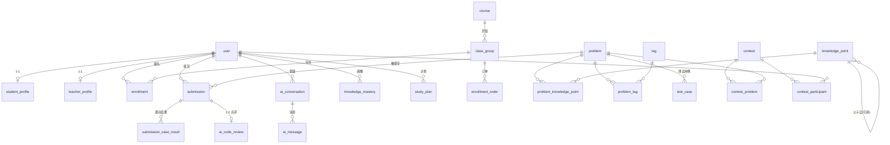

# 信奥 AI 编程训练平台 —— 数据库设计与 CRUD 实践项目需求文档

> 版本：v1.0
> 定位：**面向数据库表结构设计与增删改查（CRUD）专项训练**的实战项目
> 业务背景：信奥（信息学奥林匹克）编程培训业务 + AI 应用能力

---

## 0. 文档信息

| 项 | 内容 |
| --- | --- |
| 项目代号 | `FastAPI-database`（建议包名 `oi_trainer`） |
| 项目名称 | 信奥 AI 编程训练平台 |
| 学习主线 | 数据库表结构设计 → 增删改查 → 关联查询/聚合 → 事务/并发/约束 → 索引/性能/向量检索 |
| 技术栈 | FastAPI + PostgreSQL + Redis + SQLModel + pgvector + Alembic |
| 交付形态 | 后端 API + Alembic 迁移 + 练习脚本/测试，前端不做 |
| 参照项目 | `smartdocs-ai`（技术栈与分层约定保持一致） |

---

## 1. 项目背景与定位

### 1.1 业务背景

公司主营 **信奥（信息学奥赛）编程培训**，典型业务链路：

```
招生咨询 → 报名缴费 → 分班排课 → 授课 → 课后刷题练习 → 提交判题
        → 错题复盘/答疑 → 能力评估 → 集训/竞赛 → 升学成果
```

培训业务天然具备 **关系复杂 + 数据量大 + 状态流转多** 的特点，非常适合作为数据库设计训练场景：

- 学员、教练、课程、班级、报名、订单 → 典型教务关系模型
- 题目、知识点（树形）、标签、测试用例 → 题库模型与多对多
- 提交记录、判题明细、榜单 → 高频写入 + 聚合统计 + 排名
- AI 点评、AI 答疑、学习画像、个性化训练计划 → AI 应用融入口

### 1.2 AI 能力融入点（本项目的"AI 方向"）

| AI 能力 | 业务价值 | 落库形态 |
| --- | --- | --- |
| AI 代码点评 | 提交后自动指出逻辑错误、复杂度问题、优化建议 | `ai_code_review` |
| AI 答疑对话 | 学生就题目/知识点提问，AI 多轮解答 | `ai_conversation` / `ai_message` |
| 相似题推荐 | 基于题目向量检索"同类型/同难度"题目 | `problem.embedding` + pgvector |
| 学习画像 | 依据提交记录计算知识点掌握度 | `knowledge_mastery` |
| 个性化训练计划 | 依据画像 + 向量检索生成每日题单 | `study_plan` |

> 说明：本项目**不追求 AI 效果本身**（不训练模型），AI 只作为"产生结构化数据"的业务来源，重点在**如何为 AI 产生的数据设计表结构、如何存取分析这些数据**。

### 1.3 项目定位

- **是**：一个用于系统性训练数据库设计 + CRUD 操作的后端项目，业务真实、模型完整。
- **不是**：完整的商业产品。前端、题库内容运营、AI 模型训练均不涉及。
- **与 `smartdocs-ai` 的关系**：技术栈与工程分层保持一致；但**业务域不同、表结构不重复**，`smartdocs-ai` 侧重向量检索 RAG，本项目侧重**关系建模 + 事务/并发 + 复杂查询与聚合**。

---

## 2. 学习目标与非目标

### 2.1 学习目标

1. **表结构设计能力**：能独立设计带主外键、约束、索引、枚举、软删除、审计字段的表，并说明设计权衡。
2. **CRUD 与常用操作**：单表增删改查、分页（offset/keyset）、动态过滤、排序、批量操作。
3. **关联查询与聚合**：JOIN、预加载、子查询、GROUP BY、窗口函数、CTE。
4. **事务/并发/约束**：事务与回滚、UPSERT、悲观/乐观锁、唯一约束与幂等、软删除。
5. **索引与性能 + 向量检索**：复合/部分/表达式索引、`EXPLAIN ANALYZE`、全文检索、pgvector 相似度与混合检索。
6. **迁移与工程化**：用 Alembic 管理 schema 演进；用 Redis 处理缓存/排行榜/队列。

### 2.2 非目标

- 不实现前端页面；不实现真实判题沙箱（判题结果用模拟数据写入）。
- 不追求 AI 生成内容质量；不做模型训练/微调。
- 不检查代码格式（按你的要求忽略）。

---

## 3. 技术栈与工程约定

### 3.1 技术栈（与 `smartdocs-ai` 一致）

| 组件 | 用途 |
| --- | --- |
| FastAPI | Web 框架，提供 REST API |
| PostgreSQL 16+ | 主数据库（需 `pgvector` 扩展） |
| Redis 7 | 缓存 / 排行榜 ZSet / 判题队列 / 限流 |
| SQLModel | ORM + Schema 定义（SQLAlchemy 2.x 之上） |
| pgvector | 题目语义向量存储与相似度检索 |
| Alembic | 数据库迁移版本管理 |

### 3.2 目录结构建议（沿用 `smartdocs-ai` 分层）

```
app/
  core/        # config / db / redis / security / response / exceptions
  models/      # SQLModel 表定义（本项目重点）
  schemas/     # 请求/响应 Pydantic 模型
  routers/     # API 路由
  services/    # 业务逻辑（含 AI 调用、判题、统计）
  repositories/# 可选：数据访问层，集中 CRUD（练习 SQL 的落点）
  tasks/       # 后台任务（判题、向量化、画像重算）
  migrations/  # Alembic
  cli.py       # 本地启动/dev 脚本
scripts/       # 各阶段练习脚本（CRUD 练习题）
tests/         # pytest
```

### 3.3 通用工程约定

- **主键**：统一 `BIGSERIAL`（`id: int | None`），M:N 关联表可选复合主键。
- **时间**：统一 `TIMESTAMPTZ`（UTC 存储，`DateTime(timezone=True)`），字段名 `created_at` / `updated_at`。
- **枚举**：小范围用 Python `Enum` + PG 原生枚举或 `VARCHAR + CHECK`；文档统一用 `VARCHAR` + 枚举值说明。
- **软删除**：重要实体加 `deleted_at TIMESTAMPTZ NULL`，配套 **部分唯一索引**。
- **金额**：一律用 `BIGINT` 存"分"（`amount_cents`），避免浮点误差。
- **命名**：表名小写蛇形（`class_group`、`knowledge_point`）；索引 `ix_表_列`，唯一 `uq_表_列`。
- **迁移**：所有 schema 变更通过 Alembic 生成，禁止手改生产库。

---

## 4. 用户角色与核心业务流程

### 4.1 角色

| 角色 | 说明 |
| --- | --- |
| 学生 | 报名学习、刷题、提交、看 AI 点评、AI 答疑、查看个人画像与计划 |
| 教练（老师） | 管理班级、布置作业/竞赛、查看学员数据、人工点评 |
| 教研/管理员 | 管理课程、题目、知识点、标签、测试用例；系统配置 |
| AI 服务 | 非人类角色，产出 `ai_code_review` / `ai_message` / `study_plan` 等数据 |

### 4.2 核心业务流程图（文字）

```
[学生] 浏览课程 → 下单报名(enrollment_order) → 支付成功
      → 加入班级(class_group) → 产生选课记录(enrollment) & 占用名额(enrolled_count)
[学生] 选择题目(problem) → 提交代码(submission: pending)
      → 判题任务消费队列 → 逐测试点判题(submission_case_result)
      → 汇总状态/得分 → 触发 AI 代码点评(ai_code_review)
      → 更新知识点掌握度(knowledge_mastery) → 刷新排行榜(Redis ZSet)
[学生] AI 答疑 → 会话(ai_conversation) + 消息(ai_message)
[系统] 每日/按需 → 依据画像生成训练计划(study_plan，含向量推荐的相似题)
[教练] 创建竞赛(contest) → 挂题目(contest_problem) → 报名(contest_participant)
      → 赛后按提交计算排名(窗口函数)
```

---

## 5. 领域模型总览

分为 6 个业务域，共 **24 张表**。标注 `★` 为核心必做表，`☆` 为进阶表。

### 5.1 域划分与表清单

| 域 | 表 | 层级 |
| --- | --- | --- |
| ① 组织教务域 | `user` ★、`student_profile` ★、`teacher_profile` ☆、`course` ★、`class_group` ★、`enrollment` ★、`enrollment_order` ★ | 核心+进阶 |
| ② 题库知识域 | `knowledge_point` ★、`problem` ★、`problem_knowledge_point` ★、`tag` ☆、`problem_tag` ☆、`test_case` ★ | 核心+进阶 |
| ③ 提交判题域 | `submission` ★、`submission_case_result` ★、`ai_code_review` ★ | 核心 |
| ④ AI 答疑域 | `ai_conversation` ★、`ai_message` ★ | 核心 |
| ⑤ 学习画像与推荐域 | `knowledge_mastery` ★、`study_plan` ☆ | 核心+进阶 |
| ⑥ 竞赛域 | `contest` ☆、`contest_problem` ☆、`contest_participant` ☆ | 进阶 |
| ⑦ 审计域 | `audit_log` ☆ | 进阶 |

### 5.2 ER 关系图（Mermaid）



---

## 6. 表结构详细设计

> 每张表包含：字段定义 + 索引/约束 + **设计要点（练到的 DB 知识点）**。
> 类型为 PostgreSQL 类型；`≈` 表示 SQLModel 侧写法提示。

---

### ① 组织教务域

#### 6.1.1 `user`（用户主表）★

| 列 | 类型 | 约束 | 说明 |
| --- | --- | --- | --- |
| id | BIGSERIAL | PK | 主键 |
| username | VARCHAR(64) | NOT NULL | 登录名 |
| email | VARCHAR(255) | NULL | 邮箱 |
| phone | VARCHAR(20) | NULL | 手机号 |
| hashed_password | VARCHAR(255) | NOT NULL | 密码哈希 |
| role | VARCHAR(16) | NOT NULL | `student`/`teacher`/`admin` |
| real_name | VARCHAR(64) | NULL | 真实姓名 |
| avatar_url | TEXT | NULL | 头像 |
| status | VARCHAR(16) | NOT NULL DEFAULT 'active' | `active`/`disabled` |
| created_at | TIMESTAMPTZ | NOT NULL | 创建时间 |
| updated_at | TIMESTAMPTZ | NOT NULL | 更新时间 |
| deleted_at | TIMESTAMPTZ | NULL | 软删除 |

**索引/约束**

- `uq_user_username (username)`：全局唯一
- `uq_user_email_active (email) WHERE deleted_at IS NULL`：**部分唯一索引** —— 软删除后可复用邮箱
- `uq_user_phone_active (phone) WHERE deleted_at IS NULL`
- `ix_user_role_status (role, status)`

**设计要点**

- 软删除 + 部分唯一索引（练习点：`WHERE deleted_at IS NULL` 的部分索引语义）
- 枚举角色、时间戳审计字段（每次 UPDATE 需维护 `updated_at`）
- 随机 CRUD 查询：按 username/email 精确查、按 role+status 过滤分页

---

#### 6.1.2 `student_profile`（学生档案，与 user 1:1）★

| 列 | 类型 | 约束 | 说明 |
| --- | --- | --- | --- |
| user_id | BIGINT | PK, FK→user.id ON DELETE CASCADE | **共享主键 1:1** |
| grade | VARCHAR(8) | NULL | 年级 |
| school | VARCHAR(128) | NULL | 学校 |
| target_level | VARCHAR(16) | NULL | 目标：入门/普及/提高/省选/NOI |
| oi_level | VARCHAR(16) | NULL | 当前水平 |
| advisor_id | BIGINT | FK→user.id NULL | 教练 |
| enrolled_at | TIMESTAMPTZ | NULL | 入学时间 |
| notes | TEXT | NULL | 备注 |

**索引/约束**

- PK(user_id)（共享主键）
- `ix_student_profile_advisor (advisor_id)`

**设计要点**

- **共享主键 1:1 模式**（比"独立主键+唯一外键"更省索引）
- 自引用 user（advisor_id 指向 teacher）
- 1:1 查询练习：`JOIN` 与 `selectinload`（预加载）

---

#### 6.1.3 `teacher_profile`（教练档案，与 user 1:1）☆

| 列 | 类型 | 约束 |
| --- | --- | --- |
| user_id | BIGINT | PK, FK→user.id ON DELETE CASCADE |
| title | VARCHAR(32) | NULL |
| bio | TEXT | NULL |
| created_at | TIMESTAMPTZ | NOT NULL |

**设计要点**：与 `student_profile` 对称，练习"同一张 user 表按角色拆 1:1 扩展表"。

---

#### 6.1.4 `course`（课程）★

| 列 | 类型 | 约束 | 说明 |
| --- | --- | --- | --- |
| id | BIGSERIAL | PK | |
| code | VARCHAR(32) | NOT NULL | 课程编码 |
| title | VARCHAR(128) | NOT NULL | 标题 |
| level | VARCHAR(16) | NOT NULL | 入门/普及/提高/省选/NOI |
| description | TEXT | NULL | 简介 |
| cover_url | TEXT | NULL | 封面 |
| total_hours | INT | NOT NULL DEFAULT 0 | 总课时 |
| price_cents | BIGINT | NOT NULL DEFAULT 0 | 价格（分） |
| status | VARCHAR(16) | NOT NULL DEFAULT 'draft' | `draft`/`published`/`archived` |
| created_by | BIGINT | FK→user.id | 创建人 |
| created_at / updated_at | TIMESTAMPTZ | NOT NULL | |
| deleted_at | TIMESTAMPTZ | NULL | 软删除 |

**索引/约束**

- `uq_course_code (code) WHERE deleted_at IS NULL`
- `ix_course_status_level (status, level)`
- `gin_course_search ON to_tsvector('simple', title || ' ' || coalesce(description,''))`（全文检索）

**设计要点**

- 全文检索列 + GIN 索引（`tsvector` / 表达式索引）练习
- 状态枚举 + 软删除组合过滤（`WHERE deleted_at IS NULL AND status='published'`）
- 金额用 `BIGINT` 存分

---

#### 6.1.5 `class_group`（班级/班次）★

| 列 | 类型 | 约束 | 说明 |
| --- | --- | --- | --- |
| id | BIGSERIAL | PK | |
| course_id | BIGINT | NOT NULL, FK→course.id | 所属课程 |
| name | VARCHAR(128) | NOT NULL | 班级名 |
| teacher_id | BIGINT | NOT NULL, FK→user.id | 主讲教练 |
| campus | VARCHAR(64) | NULL | 校区 |
| start_date / end_date | DATE | NOT NULL | 起止日期 |
| capacity | INT | NOT NULL, CHECK(capacity > 0) | 名额上限 |
| enrolled_count | INT | NOT NULL DEFAULT 0 | **冗余计数**（已报名人数） |
| version | INT | NOT NULL DEFAULT 0 | **乐观锁版本号** |
| status | VARCHAR(16) | NOT NULL DEFAULT 'planned' | `planned`/`ongoing`/`finished`/`cancelled` |
| created_at / updated_at | TIMESTAMPTZ | NOT NULL |

**索引/约束**

- `CHECK (start_date <= end_date)`
- `CHECK (enrolled_count >= 0 AND enrolled_count <= capacity)`
- `ix_class_group_course (course_id)`、`ix_class_group_teacher (teacher_id)`
- `ix_class_group_status_start (status, start_date)`

**设计要点**

- **CHECK 约束**跨列校验、区间校验
- **冗余计数 `enrolled_count` + 容量约束**：事务/并发练习的主战场
- **`version` 乐观锁**：与"悲观锁 `SELECT ... FOR UPDATE`"对比练习

---

#### 6.1.6 `enrollment`（选课记录，student↔class 的 M:N）★

| 列 | 类型 | 约束 | 说明 |
| --- | --- | --- | --- |
| id | BIGSERIAL | PK | |
| student_id | BIGINT | NOT NULL, FK→user.id | 学生 |
| class_id | BIGINT | NOT NULL, FK→class_group.id | 班级 |
| status | VARCHAR(16) | NOT NULL DEFAULT 'active' | `active`/`quit`/`finished` |
| joined_at | TIMESTAMPTZ | NOT NULL | |
| quit_at | TIMESTAMPTZ | NULL | |
| final_score | NUMERIC(5,2) | NULL | 结课成绩 |
| created_at / updated_at | TIMESTAMPTZ | NOT NULL | |

**索引/约束**

- `uq_enrollment_student_class (student_id, class_id)`：同一人同一班唯一
- `ix_enrollment_class_status (class_id, status)`：按班级查学员（高频）
- `ix_enrollment_student (student_id)`

**设计要点**

- M:N 关联表的**业务化实体**（带状态与属性，而非纯 link 表）
- 复合唯一约束防重复报名
- 按班级统计人数/退课人数（`GROUP BY` + 条件聚合）

---

#### 6.1.7 `enrollment_order`（报名订单）★

| 列 | 类型 | 约束 | 说明 |
| --- | --- | --- | --- |
| id | BIGSERIAL | PK | |
| order_no | VARCHAR(32) | NOT NULL | 订单号 |
| idempotency_key | VARCHAR(64) | NULL | **幂等键** |
| student_id | BIGINT | NOT NULL, FK→user.id | |
| class_id | BIGINT | NOT NULL, FK→class_group.id | |
| amount_cents | BIGINT | NOT NULL, CHECK(amount_cents >= 0) | 金额（分） |
| status | VARCHAR(16) | NOT NULL DEFAULT 'pending' | `pending`/`paid`/`cancelled`/`refunded` |
| channel | VARCHAR(16) | NULL | 支付渠道 |
| paid_at / cancelled_at | TIMESTAMPTZ | NULL | |
| remark | TEXT | NULL | |
| created_at / updated_at | TIMESTAMPTZ | NOT NULL | |

**索引/约束**

- `uq_order_no (order_no)`
- `uq_order_idem (idempotency_key) WHERE idempotency_key IS NOT NULL`
- `ix_order_student_time (student_id, created_at DESC)`
- `ix_order_status_time (status, created_at)`

**设计要点**

- **幂等**：靠唯一键 + `INSERT ... ON CONFLICT DO NOTHING` 实现
- **状态机**：`pending→paid/cancelled`，非法流转需应用层校验 + 事务
- **按学生按时间倒序**取最近订单（keyset 分页练习）
- 支付统计：按日/按渠道聚合金额（`GROUP BY date_trunc`）

---

### ② 题库知识域

#### 6.2.1 `knowledge_point`（知识点，树形自引用）★

| 列 | 类型 | 约束 | 说明 |
| --- | --- | --- | --- |
| id | BIGSERIAL | PK | |
| code | VARCHAR(64) | NOT NULL | 知识点编码 |
| name | VARCHAR(128) | NOT NULL | 名称 |
| parent_id | BIGINT | FK→knowledge_point.id NULL | 父节点（自引用） |
| level | VARCHAR(16) | NOT NULL | 难度层级 |
| description | TEXT | NULL | |
| order_index | INT | NOT NULL DEFAULT 0 | 同层排序 |
| created_at / updated_at | TIMESTAMPTZ | NOT NULL | |

**索引/约束**

- `uq_kp_code (code)`
- `ix_kp_parent (parent_id)`
- `ix_kp_level_order (level, order_index)`

**设计要点**

- **自引用外键**（树形分类）
- **递归 CTE**：查某知识点整棵子树、查根到某节点的路径、查深度
- 禁止环：应用层校验（进阶可研究触发器/`ltree` 扩展）

---

#### 6.2.2 `problem`（题目）★

| 列 | 类型 | 约束 | 说明 |
| --- | --- | --- | --- |
| id | BIGSERIAL | PK | |
| title | VARCHAR(255) | NOT NULL | 标题 |
| statement | TEXT | NOT NULL | 题面 |
| input_format | TEXT | NULL | |
| output_format | TEXT | NULL | |
| difficulty | SMALLINT | NOT NULL, CHECK(difficulty BETWEEN 1 AND 5) | 难度 |
| source | VARCHAR(64) | NULL | 来源 |
| source_url | TEXT | NULL | 原题链接 |
| time_limit_ms | INT | NOT NULL DEFAULT 1000 | 时限 |
| memory_limit_mb | INT | NOT NULL DEFAULT 256 | 内存限制 |
| total_submissions | INT | NOT NULL DEFAULT 0 | **冗余计数** |
| accepted_submissions | INT | NOT NULL DEFAULT 0 | **冗余计数** |
| embedding | VECTOR(1024) | NULL | **语义向量**（AI 推荐用） |
| status | VARCHAR(16) | NOT NULL DEFAULT 'draft' | `draft`/`published`/`archived` |
| created_by | BIGINT | FK→user.id | |
| created_at / updated_at | TIMESTAMPTZ | NOT NULL | |
| deleted_at | TIMESTAMPTZ | NULL | 软删除 |

**索引/约束**

- `ix_problem_status_diff_id (status, difficulty, id)`：列表 + **keyset 分页**
- `ix_problem_deleted (deleted_at)`
- `gin_problem_search ON to_tsvector('simple', title || ' ' || statement)`
- `hnsw_problem_embedding USING hnsw (embedding vector_cosine_ops)`

**设计要点**

- **pgvector 列 + HNSW 索引**：相似题推荐（`embedding <=> :vec`）
- **全文检索 GIN**：题面关键词搜索
- **冗余计数**：提交后原子累加（`UPDATE ... SET x = x + 1`）
- **软删除**：题目下架但历史提交仍可追溯
- 难度/状态组合过滤 + keyset 深分页

---

#### 6.2.3 `problem_knowledge_point`（题目↔知识点 M:N）★

| 列 | 类型 | 约束 | 说明 |
| --- | --- | --- | --- |
| id | BIGSERIAL | PK | |
| problem_id | BIGINT | NOT NULL, FK→problem.id ON DELETE CASCADE | |
| knowledge_point_id | BIGINT | NOT NULL, FK→knowledge_point.id | |
| weight | SMALLINT | NOT NULL DEFAULT 1, CHECK(weight BETWEEN 1 AND 5) | 这道题对某个知识点的考察权重（1~5） |
| created_at | TIMESTAMPTZ | NOT NULL | |

**索引/约束**

- `uq_pkp (problem_id, knowledge_point_id)`
- `ix_pkp_kp_problem (knowledge_point_id, problem_id)`：**反向索引**（按知识点找题目）

**设计要点**

- M:N + 复合唯一 + **双向索引**（正向/反向查询都要快）
- 按知识点统计题目数与平均难度（`JOIN + GROUP BY + AVG`）

---

#### 6.2.4 `tag` / `problem_tag`（自由标签 M:N）☆

`tag`：`id, name VARCHAR(32) NOT NULL, kind VARCHAR(16) NOT NULL, created_at`，`uq_tag_name_kind (name, kind)`

`problem_tag`：`problem_id, tag_id` 组成**复合主键**，均 `FK ON DELETE CASCADE`

**设计要点**

- **复合主键的 M:N**（无代理键，对比 6.2.3 的代理键风格）
- 标签云统计：`GROUP BY tag_id ORDER BY count DESC LIMIT n`

---

#### 6.2.5 `test_case`（测试用例）★

| 列 | 类型 | 约束 | 说明 |
| --- | --- | --- | --- |
| id | BIGSERIAL | PK | |
| problem_id | BIGINT | NOT NULL, FK→problem.id ON DELETE CASCADE | |
| case_index | INT | NOT NULL | 用例序号 |
| input_data | TEXT | NULL | 输入 |
| expected_output | TEXT | NULL | 期望输出 |
| is_sample | BOOLEAN | NOT NULL DEFAULT false | 是否样例（可公开） |
| score | SMALLINT | NOT NULL DEFAULT 0 | 该用例分值 |
| created_at | TIMESTAMPTZ | NOT NULL | |

**索引/约束**

- `uq_testcase_problem_index (problem_id, case_index)`
- `ix_testcase_problem_sample (problem_id, is_sample)`

**设计要点**

- 1:N + **级联删除**（删题自动删用例）
- 布尔字段 + 部分过滤（只取样例）
- 题目总分 = 用例分值之和（`SUM ... GROUP BY`）

---

### ③ 提交判题域

#### 6.3.1 `submission`（提交记录，高频写入）★

| 列 | 类型 | 约束 | 说明 |
| --- | --- | --- | --- |
| id | BIGSERIAL | PK | |
| problem_id | BIGINT | NOT NULL, FK→problem.id | |
| student_id | BIGINT | NOT NULL, FK→user.id | |
| contest_id | BIGINT | FK→contest.id NULL | 是否竞赛提交 |
| language | VARCHAR(16) | NOT NULL | `cpp`/`python`/`java` |
| code | TEXT | NOT NULL | 代码 |
| code_hash | CHAR(64) | NULL | sha256（查重） |
| status | VARCHAR(24) | NOT NULL DEFAULT 'pending' | 见状态机 |
| score | SMALLINT | NOT NULL DEFAULT 0 | 得分 |
| time_used_ms | INT | NULL | |
| memory_used_kb | INT | NULL | |
| judge_detail | JSONB | NULL | 判题汇总（各点结果） |
| submitted_at | TIMESTAMPTZ | NOT NULL | |
| judged_at | TIMESTAMPTZ | NULL | |
| created_at | TIMESTAMPTZ | NOT NULL | |

**状态机**：`pending → judging → accepted | wrong_answer | time_limit_exceeded | memory_limit_exceeded | runtime_error | compile_error | system_error`

**索引/约束**

- `ix_sub_student_time (student_id, submitted_at DESC)`：我的提交列表
- `ix_sub_problem_status (problem_id, status)`
- `ix_sub_contest_student (contest_id, student_id)`
- `ix_sub_pending ON (id) WHERE status = 'pending'`：**部分索引**（判题队列拉取）
- `gin_sub_judge_detail USING gin (judge_detail jsonb_path_ops)`

**设计要点**

- **JSONB + GIN**：存非结构化判题明细并支持查询
- **部分索引**：只为待判题行建索引
- **窗口函数**：每个学生每道题的最佳/首次 AC 提交（`ROW_NUMBER()/RANK() OVER (PARTITION BY ...)`）
- **keyset 分页**：按 `submitted_at DESC, id DESC` 翻页
- 状态流转事务 + 计数冗余更新（`problem.total_submissions`）

---

#### 6.3.2 `submission_case_result`（逐测试点结果）★

| 列 | 类型 | 约束 | 说明 |
| --- | --- | --- | --- |
| id | BIGSERIAL | PK | |
| submission_id | BIGINT | NOT NULL, FK→submission.id ON DELETE CASCADE | |
| test_case_id | BIGINT | NOT NULL, FK→test_case.id | |
| status | VARCHAR(24) | NOT NULL | 单点状态 |
| time_used_ms | INT | NULL | |
| memory_used_kb | INT | NULL | |
| score | SMALLINT | NOT NULL DEFAULT 0 | |
| created_at | TIMESTAMPTZ | NOT NULL | |

**索引/约束**

- `uq_scr_submission_case (submission_id, test_case_id)`
- `ix_scr_testcase (test_case_id)`：反向统计"最常挂的用例"

**设计要点**

- 明细表 1:N + 唯一约束
- 聚合反推提交得分（`SUM(score)`）；对比冗余 `submission.score` 的一致性
- 找出"卡住最多学生的测试点"（`GROUP BY test_case_id ORDER BY count DESC`）

---

#### 6.3.3 `ai_code_review`（AI 代码点评，与 submission 1:1）★

| 列 | 类型 | 约束 | 说明 |
| --- | --- | --- | --- |
| id | BIGSERIAL | PK | |
| submission_id | BIGINT | NOT NULL, **UNIQUE**, FK→submission.id ON DELETE CASCADE | 1:1 |
| model_name | VARCHAR(64) | NULL | 模型 |
| prompt_version | VARCHAR(32) | NULL | 提示词版本 |
| review_text | TEXT | NULL | 点评正文 |
| error_type | VARCHAR(24) | NULL | 逻辑错误/边界条件/复杂度/风格/无 |
| suggestions | JSONB | NULL | 结构化建议 |
| suggested_score | SMALLINT | NULL | AI 建议分 |
| tokens_input / tokens_output | INT | NULL | 用量 |
| cost_cents | NUMERIC(10,4) | NULL | 成本 |
| latency_ms | INT | NULL | 耗时 |
| status | VARCHAR(16) | NOT NULL DEFAULT 'pending' | `pending`/`done`/`failed` |
| error_message | TEXT | NULL | |
| created_at / updated_at | TIMESTAMPTZ | NOT NULL | |

**索引/约束**

- `uq_review_submission (submission_id)`
- `ix_review_status (status)`、`gin_review_suggestions USING gin (suggestions)`

**设计要点**

- **1:1 唯一外键**模式
- AI 调用记录：token/成本/耗时统计（按模型聚合 `GROUP BY model_name`）
- JSONB 结构化建议查询（`suggestions @> '{"complexity": true}'`）

---

### ④ AI 答疑域

#### 6.4.1 `ai_conversation`（答疑会话）★

| 列 | 类型 | 约束 | 说明 |
| --- | --- | --- | --- |
| id | BIGSERIAL | PK | |
| student_id | BIGINT | NOT NULL, FK→user.id | |
| problem_id | BIGINT | FK→problem.id NULL | 针对某题（可空） |
| kind | VARCHAR(16) | NOT NULL | `qa`/`hint`/`walkthrough` |
| title | VARCHAR(128) | NULL | 会话标题 |
| message_count | INT | NOT NULL DEFAULT 0 | **冗余计数** |
| last_message_at | TIMESTAMPTZ | NULL | 便于排序 |
| created_at / updated_at | TIMESTAMPTZ | NOT NULL | |
| deleted_at | TIMESTAMPTZ | NULL | 软删除 |

**索引/约束**

- `ix_conv_student_last (student_id, last_message_at DESC)`
- `ix_conv_problem (problem_id)`

**设计要点**：冗余计数 + 排序字段（避免每次 COUNT 消息表）；软删除。

---

#### 6.4.2 `ai_message`（消息）★

| 列 | 类型 | 约束 | 说明 |
| --- | --- | --- | --- |
| id | BIGSERIAL | PK | |
| conversation_id | BIGINT | NOT NULL, FK→ai_conversation.id ON DELETE CASCADE | |
| role | VARCHAR(16) | NOT NULL | `system`/`user`/`assistant`/`tool` |
| content | TEXT | NOT NULL | |
| model_name | VARCHAR(64) | NULL | |
| tokens | INT | NULL | |
| latency_ms | INT | NULL | |
| created_at | TIMESTAMPTZ | NOT NULL | |

**索引/约束**

- `ix_msg_conv_id (conversation_id, id)`
- `gin_msg_content ON to_tsvector('simple', content)`（检索历史提问）

**设计要点**

- 1:N 分页（**取最近 N 条构建上下文**：`ORDER BY id DESC LIMIT n` 后反转）
- 级联删除；会话内消息序号即主键顺序
- 全文检索历史问答

---

### ⑤ 学习画像与推荐域

#### 6.5.1 `knowledge_mastery`（学生×知识点掌握度）★

| 列 | 类型 | 约束 | 说明 |
| --- | --- | --- | --- |
| id | BIGSERIAL | PK | |
| student_id | BIGINT | NOT NULL, FK→user.id | |
| knowledge_point_id | BIGINT | NOT NULL, FK→knowledge_point.id | |
| mastery_score | SMALLINT | NOT NULL DEFAULT 0, CHECK(0..100) | 掌握度 |
| attempts | INT | NOT NULL DEFAULT 0 | 尝试次数 |
| accepted_count | INT | NOT NULL DEFAULT 0 | AC 次数 |
| last_practiced_at | TIMESTAMPTZ | NULL | |
| created_at / updated_at | TIMESTAMPTZ | NOT NULL | |

**索引/约束**

- `uq_km_student_kp (student_id, knowledge_point_id)`：**UPSERT 目标键**
- `ix_km_kp_score (knowledge_point_id, mastery_score)`

**设计要点**

- **UPSERT**：`INSERT ... ON CONFLICT (student_id, knowledge_point_id) DO UPDATE SET ...`
- 增量更新（每次提交后 +attempts，AC 时 +accepted_count 并重算 score）
- **从 `submission` 派生**：按知识点聚合统计作为回填来源（`JOIN` 三表 + `GROUP BY`）
- 弱项分析：`mastery_score < 60 ORDER BY` 配合知识点树

---

#### 6.5.2 `study_plan`（AI 个性化训练计划）☆

| 列 | 类型 | 约束 | 说明 |
| --- | --- | --- | --- |
| id | BIGSERIAL | PK | |
| student_id | BIGINT | NOT NULL, FK→user.id | |
| plan_date | DATE | NOT NULL | 计划日期 |
| generated_by | VARCHAR(16) | NOT NULL | `ai`/`teacher`/`system` |
| items | JSONB | NOT NULL | 题目列表 + 推荐理由 + 知识点 |
| summary | TEXT | NULL | 计划说明 |
| status | VARCHAR(16) | NOT NULL DEFAULT 'active' | `active`/`completed`/`expired` |
| created_at / updated_at | TIMESTAMPTZ | NOT NULL | |

**索引/约束**

- `uq_plan_student_date (student_id, plan_date)`：每日一份
- `ix_plan_date_status (plan_date, status)`
- `gin_plan_items USING gin (items jsonb_path_ops)`

**设计要点**

- JSONB 数组：`items @> '[{"problem_id": 12}]'` 查"哪些计划包含某题"
- 按日期范围查询、日期唯一约束
- 与向量推荐联动：`items` 中的相似题来源 `problem.embedding` 检索

---

### ⑥ 竞赛域 ☆

#### 6.6.1 `contest`（竞赛）

`id, title VARCHAR(128) NOT NULL, course_id BIGINT FK, contest_type VARCHAR(16) NOT NULL (oi/acm/mock), rules JSONB, start_at TIMESTAMPTZ NOT NULL, end_at TIMESTAMPTZ NOT NULL, freeze_at TIMESTAMPTZ NULL, status VARCHAR(16) NOT NULL (not_started/running/finished/frozen), created_by BIGINT FK, created_at, updated_at`

约束：`CHECK (start_at < end_at)`；索引 `ix_contest_status_start (status, start_at)`。

#### 6.6.2 `contest_problem`（竞赛↔题目 M:N）

`id, contest_id FK, problem_id FK, alias CHAR(2) NOT NULL, order_index INT NOT NULL, max_score SMALLINT NOT NULL`
约束：`uq_cp (contest_id, problem_id)`、`uq_cp_alias (contest_id, alias)`。

#### 6.6.3 `contest_participant`（竞赛↔学生 M:N）

`id, contest_id FK, student_id FK, registered_at TIMESTAMPTZ, score INT DEFAULT 0, rank INT NULL, solved_count INT DEFAULT 0, penalty INT DEFAULT 0`
约束：`uq_participant (contest_id, student_id)`。

**竞赛域设计要点**

- 双 M:N（题目/学生）
- **排名计算用窗口函数**：`RANK()/DENSE_RANK() OVER (PARTITION BY contest_id ORDER BY score DESC, penalty ASC)`，结果回写 `rank` 字段（批量 UPSERT）
- 封榜逻辑（`freeze_at` 后的提交不计入实时榜）
- 竞赛内提交统计：按 `contest_id` 关联 `submission` 聚合

---

### ⑦ 审计域 ☆

#### 6.7.1 `audit_log`（操作审计）

`id, actor_id BIGINT FK→user.id NULL, actor_role VARCHAR(16), action VARCHAR(64) NOT NULL, entity_type VARCHAR(32) NOT NULL, entity_id BIGINT, before_data JSONB, after_data JSONB, ip VARCHAR(45), user_agent TEXT, created_at TIMESTAMPTZ NOT NULL`

索引：`ix_audit_entity (entity_type, entity_id)`、`ix_audit_actor_time (actor_id, created_at DESC)`、`ix_audit_created (created_at)`。

**设计要点**

- 只写不改（append-only），与业务事务同事务写入
- JSONB 存前后快照做 diff
- 大量写入场景 → 进阶练习 **按月分区表**（`PARTITION BY RANGE (created_at)`）

---

## 7. Redis 辅助设计（与 DB 联动）

| 场景 | Redis 结构 | 与 DB 关系 |
| --- | --- | --- |
| 竞赛实时排行榜 | ZSet `contest:{id}:rank` | 数据源为 `submission`，定时/触发回写 DB |
| 待判题队列 | List/Stream `judge:queue` | 生产者写 `submission`，消费者更新状态 |
| 题目/课程热点缓存 | String/Hash `problem:{id}` | 缓存 DB 查询，练习缓存一致性 |
| 每日推荐 | ZSet/String | 由 `study_plan` 生成 |
| 接口限流 | 计数器 | 沿用 `smartdocs-ai` 的 slowapi |

---

## 8. CRUD 与常用操作任务清单（按阶段）

> 每个任务给出：**目标 → 涉及表 → 关键操作/SQL 要点**。建议按阶段顺序推进，每阶段产物用 `scripts/阶段N_*.py` 或 pytest 沉淀。

### 阶段 1：基础 CRUD + 分页/过滤/排序（表：user、course、class_group、knowledge_point、problem、tag）

| # | 任务 | 涉及表 | 关键要点 |
| --- | --- | --- | --- |
| 1.1 | 用户创建/详情/更新/软删除 | user | `INSERT`（唯一冲突处理）、`UPDATE ... WHERE deleted_at IS NULL`、软删除 = 置 `deleted_at` |
| 1.2 | 用户列表：分页 + 动态过滤 + 排序 | user | `LIMIT/OFFSET`、可组合 `WHERE role=?, status=?`、`ORDER BY created_at DESC` |
| 1.3 | 课程 CRUD + 状态流转 | course | 枚举状态、软删除+部分唯一索引冲突验证（删后同名 code 可复用） |
| 1.4 | 批量创建/批量软删除 | course/tag | `INSERT ... VALUES (...),(...)`、`UPDATE ... WHERE id = ANY(:ids)` |
| 1.5 | 存在性判断 / 计数 | 任意 | `SELECT EXISTS(...)`、`COUNT(*)` |
| 1.6 | 知识点树基础 CRUD | knowledge_point | 自引用父节点、同层排序 `order_index` |
| 1.7 | 题目列表：keyset 深分页 | problem | `WHERE (difficulty, id) > (:d, :id) ORDER BY difficulty, id LIMIT n`（对比 OFFSET 性能） |
| 1.8 | 幂等创建（模拟重复请求） | enrollment_order | `INSERT ... ON CONFLICT (order_no) DO NOTHING RETURNING` |

### 阶段 2：关联查询与聚合（表：enrollment、problem_knowledge_point、test_case、submission、submission_case_result、contest_participant）

| # | 任务 | 涉及表 | 关键要点 |
| --- | --- | --- | --- |
| 2.1 | 班级学员名单（含学生档案） | class_group + enrollment + user + student_profile | 多表 `JOIN` vs ORM `selectinload` 预加载 |
| 2.2 | 某学生的全部选课（含课程信息） | enrollment + class_group + course | 反向一对多查询 |
| 2.3 | 题目详情（含知识点 + 标签 + 样例用例） | problem + problem_knowledge_point + problem_tag + test_case | 一对多批量加载、`in` 查询避免 N+1 |
| 2.4 | 按知识点统计题目数/平均难度 | problem_knowledge_point + problem | `JOIN + GROUP BY + COUNT/AVG` |
| 2.5 | 知识点子树查询（递归） | knowledge_point | **递归 CTE** `WITH RECURSIVE` 查子树/路径/深度 |
| 2.6 | 学生题目正确率 | submission | 条件聚合 `COUNT(*) FILTER (WHERE status='accepted') / COUNT(*)` |
| 2.7 | 每学生每题最佳提交 | submission | **窗口函数** `ROW_NUMBER() OVER (PARTITION BY student_id, problem_id ORDER BY score DESC, submitted_at)` |
| 2.8 | 提交逐点明细汇总 | submission_case_result | `GROUP BY submission_id` 聚合；对比 `submission.score` 冗余一致性 |
| 2.9 | 竞赛排名（重算并回写） | contest_participant + submission | `DENSE_RANK() OVER (...)` + 批量 UPSERT 回写 `rank` |
| 2.10 | 挂题最多的测试点 TOP N | submission_case_result + test_case | `GROUP BY test_case_id ORDER BY count DESC` + `JOIN` |
| 2.11 | 按日/渠道统计订单金额 | enrollment_order | `date_trunc('day', created_at)`、`SUM ... GROUP BY`、多维度 `GROUPING SETS`（进阶） |

### 阶段 3：事务 / 并发 / 约束（表：class_group、enrollment、enrollment_order、submission、ai_code_review、audit_log）

| # | 任务 | 涉及表 | 关键要点 |
| --- | --- | --- | --- |
| 3.1 | 并发报名（悲观锁） | class_group + enrollment | `SELECT ... FOR UPDATE` 锁班级行 → 校验名额 → `enrolled_count += 1` → 插选课，全程单事务 |
| 3.2 | 并发报名（乐观锁） | class_group | `UPDATE ... SET version=version+1 WHERE id=? AND version=? AND enrolled_count < capacity`，影响行数=0 则重试 |
| 3.3 | 下单幂等 + 超卖防护 | enrollment_order + class_group | 唯一键幂等 + 名额 CHECK 约束兜底 |
| 3.4 | 订单支付状态流转 | enrollment_order | 事务内 `pending→paid` 并用 `WHERE status='pending'` 保证仅一次生效 |
| 3.5 | 判题流程事务 | submission + submission_case_result + problem | 单事务：写明细 → 汇总状态/得分 → 累加冗余计数 → 更新 `judged_at` |
| 3.6 | 重复提交去重 | submission | `code_hash` + `(student_id, problem_id, code_hash)` 唯一约束（或部分索引） |
| 3.7 | AI 点评写入（1:1 唯一） | ai_code_review | `ON CONFLICT (submission_id) DO UPDATE`（重试不产生重复） |
| 3.8 | 审计日志同事务写入 | audit_log | 业务变更 + 审计在同一事务；回滚时审计一并回滚 |
| 3.9 | 软删除与唯一约束冲突验证 | user/course | 验证"删除后同名可重建"与"未删除时不可重复" |
| 3.10 | 批量 UPSERT 掌握度 | knowledge_mastery | `ON CONFLICT (student_id, knowledge_point_id) DO UPDATE` 增量更新 |

### 阶段 4：索引 / 性能 / 向量检索（表：problem、submission、ai_message、course）

| # | 任务 | 涉及表 | 关键要点 |
| --- | --- | --- | --- |
| 4.1 | 复合索引与最左前缀验证 | submission/problem | 造 10w+ 数据，`EXPLAIN ANALYZE` 对比有无索引、索引列顺序的影响 |
| 4.2 | 部分索引收益验证 | submission | `WHERE status='pending'` 的部分索引 vs 全表索引，对比索引大小与查询计划 |
| 4.3 | 表达式索引 + 全文检索 | course/problem | `to_tsvector(...)` GIN，`tsquery` 搜索 + 排名 `ts_rank` |
| 4.4 | 覆盖索引/仅索引扫描 | submission | `SELECT student_id, id ...` 走覆盖索引，观察 `Index Only Scan` |
| 4.5 | keyset vs offset 分页压测 | submission | 深翻页耗时对比，验证 `(submitted_at, id)` 复合索引 |
| 4.6 | pgvector 相似题推荐 | problem | 写入题目 embedding，`ORDER BY embedding <=> :vec LIMIT k`，HNSW 索引对比暴力扫描 |
| 4.7 | 混合检索 | problem + problem_knowledge_point | 知识点过滤 + 向量排序（先过滤再排序 / 分区检索） |
| 4.8 | 冗余计数一致性校验与修复 | problem/class_group | 用明细表重算计数并对比、批量修正 |
| 4.9 | 慢查询定位 | audit_log/submission | `pg_stat_statements`（进阶）或 `EXPLAIN (ANALYZE, BUFFERS)` 分析 |

### 阶段 5（进阶串讲）：AI 流水线与统计

| # | 任务 | 涉及表 | 关键要点 |
| --- | --- | --- | --- |
| 5.1 | 提交→判题→AI点评→画像→推荐 全链路 | 多表 | 事务边界划分、任务队列（Redis）、幂等与重试 |
| 5.2 | 学生能力雷达/弱项分析 | knowledge_mastery + knowledge_point | 递归树 + 聚合，输出到 API |
| 5.3 | 相似题驱动的训练计划生成 | study_plan + problem | 向量检索 + JSONB 落库 + 每日唯一 |
| 5.4 | 竞赛实时榜（Redis ZSet + 回写 DB） | contest_participant + Redis | 缓存与 DB 一致性 |
| 5.5 | 审计日志按月分区 | audit_log | 分区表创建/维护（进阶） |

---

## 9. Alembic 迁移与数据种子策略

- **迁移粒度**：建议按"域"拆迁移（如 `init_org_tables`、`init_problem_tables`、`add_problem_embedding`、`add_partial_indexes`），保持每个 revision 语义单一。
- **扩展安装**：首个迁移里执行 `CREATE EXTENSION IF NOT EXISTS vector;`（在 `env.py` 中处理或用 `op.execute`）。
- **索引变更**：HNSW/GIN/部分索引均通过 `op.create_index(..., postgresql_using=..., postgresql_where=...)` 表达。
- **种子数据**：提供 `scripts/seed_*.py` 生成一批：用户（学生/教练/管理员）、课程、班级、知识点树、题目（含向量）、测试用例、历史提交——用于阶段 2/4 的聚合与压测。
- **数据规模**：阶段 4 压测建议 `submission ≥ 10 万行`、`problem ≥ 5 千行`，才能体现索引差异。

---

## 10. 非功能需求与验收标准

| 维度 | 要求 |
| --- | --- |
| 一致性 | 冗余计数（`problem.total_submissions`、`class_group.enrolled_count`、`ai_conversation.message_count`）与明细可重算一致 |
| 并发 | 同一班级并发报名不超卖；同一订单重复请求不重复扣减 |
| 查询性能 | 阶段 4 主要列表接口在 10 万级数据下 `EXPLAIN` 命中索引，深分页不随页深线性劣化 |
| 向量检索 | 相似题 Top-K 查询走 HNSW 索引，响应满足交互要求 |
| 可迁移 | 所有表结构变更均有 Alembic 迁移文件，可从零 `upgrade head` 建库 |
| 幂等 | 下单/判题/点评接口可重试不产生重复数据 |

**阶段性验收（示例）**

- 阶段 1 通过：能用接口 + 脚本完成 6 张核心表的完整 CRUD，分页/过滤/排序参数可组合。
- 阶段 2 通过：给出 10+ 条聚合/关联查询，含至少 1 条递归 CTE 与 1 条窗口函数。
- 阶段 3 通过：并发脚本证明不超卖；幂等脚本证明重复下单只成功一次。
- 阶段 4 通过：给出 5 组 `EXPLAIN ANALYZE` 前后对比 + 向量检索可用。

---

## 11. 分阶段里程碑（推进方式）

| 阶段 | 主题 | 核心表 | 主要练习点 | 里程碑产物 |
| --- | --- | --- | --- | --- |
| 0 | 项目脚手架 | — | 分层结构、Alembic 初始化、连接池 | 可 `upgrade head` 建库 |
| 1 | 基础 CRUD | user/course/class_group/knowledge_point/problem | 增删改查、分页过滤排序、批量、软删除、幂等插入 | 6 表 CRUD API + 练习脚本 |
| 2 | 关联与聚合 | enrollment/submission/knowledge_point 等 | JOIN、预加载、递归 CTE、窗口函数、GROUP BY | 10+ 查询清单 |
| 3 | 事务/并发/约束 | class_group/enrollment_order/submission | 事务、行锁/乐观锁、UPSERT、幂等、审计 | 并发与幂等验证脚本 |
| 4 | 索引/性能/向量 | problem/submission | 复合/部分/表达式索引、EXPLAIN、全文检索、pgvector | 性能对比报告 + 相似题接口 |
| 5 | 进阶串联 | 全表 | AI 流水线、缓存一致性、统计、分区 | 端到端链路 demo |

> 推进原则：**每个阶段只引入新表 + 新知识点，学一个练一个**；旧表在新阶段继续复用（如 `submission` 在阶段 2/3/4 反复出现，逐步加深）。

---

## 12. 附录

### 12.1 命名与类型规范速查

| 项 | 规范 |
| --- | --- |
| 表名 | 小写蛇形，复数不加 s（`class_group`） |
| 主键 | `id BIGSERIAL` |
| 外键 | `xxx_id BIGINT` + FK 约束，明确 `ON DELETE` |
| 索引 | `ix_表_列` / `uq_表_列` / `gin_` / `hnsw_` 前缀 |
| 时间 | `TIMESTAMPTZ`，字段 `created_at/updated_at/deleted_at` |
| 金额 | `BIGINT`（分） |
| 布尔 | `is_xxx BOOLEAN NOT NULL DEFAULT false` |
| 枚举 | `VARCHAR(n)` + 文档枚举表（或 PG enum） |

### 12.2 枚举字典（节选）

- `user.role`：student / teacher / admin
- `course.status`：draft / published / archived
- `class_group.status`：planned / ongoing / finished / cancelled
- `enrollment.status`：active / quit / finished
- `enrollment_order.status`：pending / paid / cancelled / refunded
- `problem.status`：draft / published / archived
- `submission.status`：pending / judging / accepted / wrong_answer / time_limit_exceeded / memory_limit_exceeded / runtime_error / compile_error / system_error
- `ai_message.role`：system / user / assistant / tool
- `ai_code_review.error_type`：logic / boundary / complexity / style / none
- `study_plan.generated_by`：ai / teacher / system
- `contest.status`：not_started / running / finished / frozen

### 12.3 与 `smartdocs-ai` 的差异点（学习增量）

| 维度 | smartdocs-ai | 本项目 |
| --- | --- | --- |
| 侧重 | 向量检索 / RAG 链路 | 关系建模 + CRUD + 事务并发 + 复杂查询聚合 |
| 表数量 | 少而精 | 多域 24 表，含自引用树、双 M:N、冗余计数、审计 |
| 重点操作 | 相似度检索 | UPSERT/锁/幂等/窗口函数/递归 CTE/分区 |
| 业务 | 文档问答 | 信奥培训教务 + 刷题判题 + AI 辅助 |

---

> 本文档为**需求与设计基线**。若后续需要，可据此拆解为：① 分阶段建表迁移清单；② 各阶段接口清单；③ 练习题清单（SQL + ORM 双写法）。
